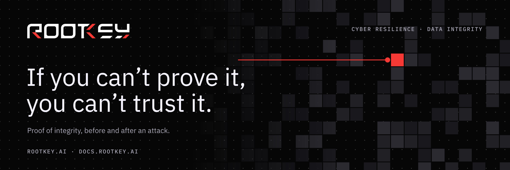
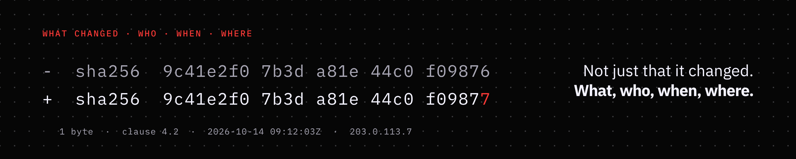
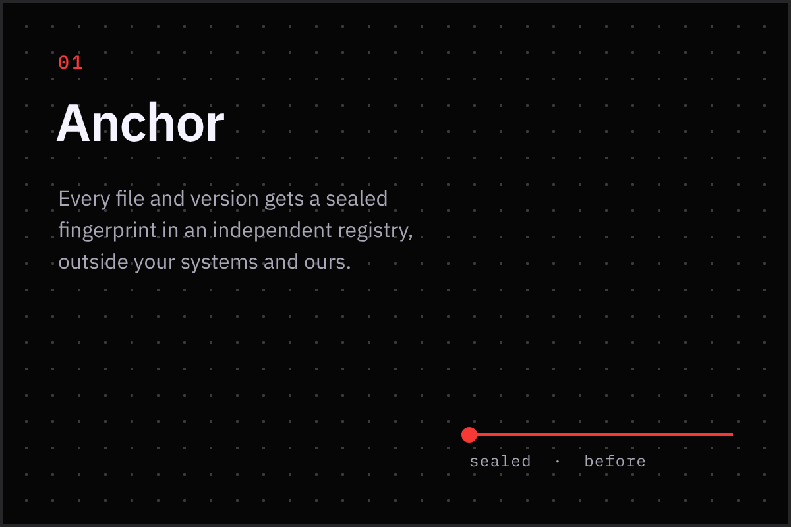
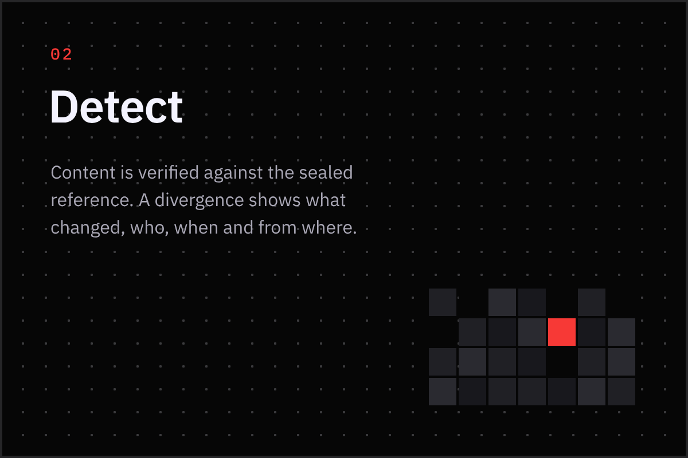
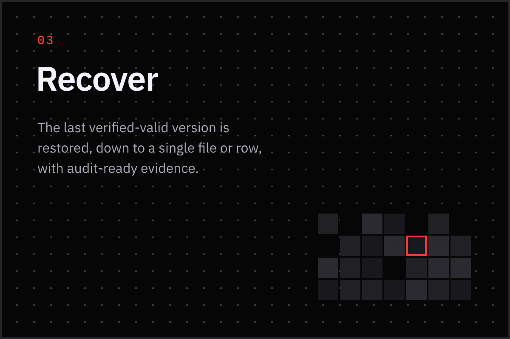
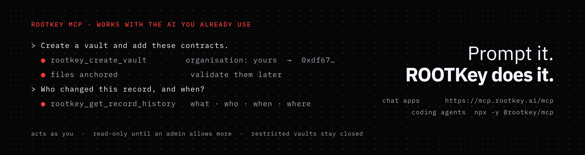
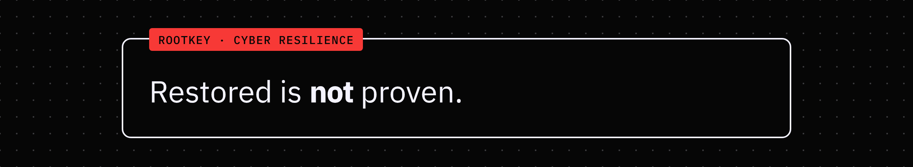
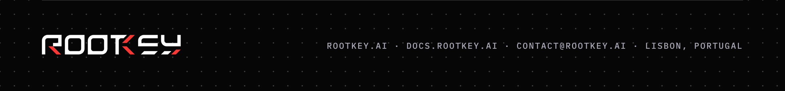

  

**ROOTKey is a cyber resilience platform that proves the integrity of data before and after an attack.** It records what changed, who changed it, when, and from where, and can restore the last verified-valid version down to a single file or row. It deploys as SaaS, in a private cloud, or on-premise, integrates with SharePoint, OneDrive, Amazon S3 and Cloudflare R2, and offers a REST API.

Most companies can restore systems. Few can prove their data is still trustworthy.

  

## Anchor · Detect · Recover

  
  
  

Every file and version is sealed in an independent registry, outside your systems and ours. Content is verified against that sealed reference, and a divergence shows what changed, who, when and from where. The last verified-valid version is restored, down to a single file or row, with audit-ready evidence. How it works, in detail: [rootkey.ai/platform/how-it-works](https://www.rootkey.ai/platform/how-it-works).

## Use ROOTKey from the AI you already use

  

ROOTKey has an MCP server. Ask in plain language and your assistant adds files, creates vaults and tables, reads audit trails and integrates ROOTKey into your code, with your permissions and never more.

- **Chat apps** (Claude, ChatGPT, GitHub Copilot, OpenAI Codex): add `https://mcp.rootkey.ai/mcp` as a custom connector and sign in to ROOTKey. No token to create or paste.
- **Coding agents** (Claude Code, Cursor, Gemini CLI, Windsurf): run the official server, `npx -y @rootkey/mcp` (Node.js 20 or later), with a personal access token.
- **Governance:** a connected app acts as you and never has more access than you have in the ROOTKey app. Agents are read-only until an organisation admin allows full access. Restricted vaults and tables stay closed. Every change an agent makes names the organisation it acted in.

Step-by-step for each assistant, and the FAQ: [rootkey.ai/platform/mcp](https://www.rootkey.ai/platform/mcp).

## Build with ROOTKey

| What | Where |
|---|---|
| **REST API** | Documented at [docs.rootkey.ai](https://docs.rootkey.ai). |
| **Connectors** | SharePoint, OneDrive, Amazon S3, Cloudflare R2 — [integrations](https://www.rootkey.ai/platform/integrations). |
| **Deployment** | SaaS, private cloud or on-premise — [deployment](https://www.rootkey.ai/platform/deployment). |
| **Public verification** | Check a proof yourself at [rootkey.ai/verify](https://www.rootkey.ai/verify). |
| **For regulated teams** | [NIS2](https://www.rootkey.ai/enterprise/nis2) · [DORA](https://www.rootkey.ai/enterprise/dora) · [GDPR](https://www.rootkey.ai/enterprise/gdpr) · [Trust centre](https://www.rootkey.ai/trust). |

  

## Talk to us

Website [rootkey.ai](https://www.rootkey.ai) · Docs [docs.rootkey.ai](https://docs.rootkey.ai) · Press & media kit [rootkey.ai/press-media](https://www.rootkey.ai/press-media) · Careers [rootkey.ai/careers](https://www.rootkey.ai/careers) · [contact@rootkey.ai](mailto:contact@rootkey.ai)

ROOTKey is a member of the Anthropic startup program.

  

